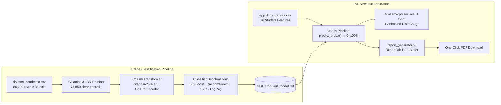

<div align="center">

# 🎓 Student Dropout Risk Prediction Engine

**End-to-End Student Retention & Early-Warning ML Platform with Probabilistic Risk Scoring, Animated Gauge UI & Automated PDF Intervention Reports**

[](https://www.python.org/)
[](https://streamlit.io/)
[](https://scikit-learn.org/)
[](https://xgboost.readthedocs.io/)
[](https://www.reportlab.com/)


*Identify at-risk students early from 80,000+ academic, psychological, and lifestyle records — delivering calibrated dropout probabilities, animated visual gauges, and actionable PDF counseling reports.*

</div>

---

## ⚡ Overview

Student attrition rarely happens overnight; it builds across declining attendance, rising stress and exam anxiety, poor sleep hygiene, and weakening academic momentum. This repository provides a **complete machine learning classification pipeline and interactive Streamlit web application** that computes calibrated dropout probabilities (`0%–100%`) and generates tailored PDF intervention reports in one click.

* **80,000-Record Data Pipeline with IQR Outlier Filtering** — Cleans `dataset_academic.csv` (80,000 rows × 31 columns), verifies zero nulls/duplicates, and applies IQR-based outlier pruning across core academic and lifestyle metrics (`75,850` clean records).
* **Multi-Classifier Benchmarking** — Trains and compares `XGBClassifier`, `RandomForestClassifier`, `SVC`, and `LogisticRegression` inside a unified `scikit-learn` `Pipeline` (`StandardScaler` + `OneHotEncoder`).
* **Dark Glassmorphism UI with Animated Risk Gauge** — Styled via `styles.css` with frosted-glass cards, `Space Grotesk` + `Inter` typography, pop-in animations, and a live color-coded probability gauge.
* **Automated PDF Intervention Reports** — `report_generator.py` renders in-memory `ReportLab` PDF assessments complete with ASCII-sanitized status summaries, full student profile tables, and tiered retention recommendations.

---

## 🏗️ System Architecture



---

## 🧬 Data Cleaning & Model Feature Schema

### Data Preprocessing & Outlier Handling
* **Null & Duplicate Audit:** Validated 0 missing values and removed duplicate entries across all 80,000 student records.
* **IQR Outlier Pruning:** Filtered extreme values outside `[Q1 - IQR, Q3 + IQR]` across 5 key distributions (`study_hours_per_day`, `sleep_hours`, `previous_gpa`, `screen_time`, `exam_score`), retaining **75,850 high-signal records** verified with before-and-after boxplots.

### Inference Feature Schema (16 Model Inputs)
| Type | Features | Preprocessing |
| :--- | :--- | :--- |
| **Numerical (9)** | `stress_level`, `motivation_level`, `exam_anxiety_score`, `previous_gpa`, `exam_score`, `mental_health_rating`, `exercise_frequency`, `sleep_hours`, `attendance_percentage` | `StandardScaler` |
| **Categorical (7)** | `parental_education_level` *(5 options)*, `major` *(6 options)*, `study_environment` *(5 options)*, `diet_quality` *(3 options)*, `learning_style` *(4 options)*, `family_income_range` *(3 options)*, `gender` *(3 options)* | `OneHotEncoder` |

---

## 🧠 Machine Learning Pipeline

1. **Exploratory Visual Diagnostics** — Multi-panel `seaborn` boxplot sweeps before and after IQR filtering across all numerical attributes.
2. **Leakage-Free Preprocessing** — Encapsulates `StandardScaler` and `OneHotEncoder` inside a `ColumnTransformer` + `Pipeline` so live app inputs undergo the exact same transformations as training data.
3. **Model Comparison** — Benchmarks four classification families on held-out test splits using **Accuracy** and full **Classification Reports** (Precision, Recall, F1-Score):
   * `XGBClassifier` (Gradient Boosted Decision Trees)
   * `RandomForestClassifier` (Bagged Tree Ensemble)
   * `SVC` (Support Vector Classifier)
   * `LogisticRegression` (Linear Baseline)
4. **Probabilistic Serving** — Serializes the top pipeline to `best_drop_out_model.pkl` via `joblib` and queries `model.predict_proba()` at runtime for granular risk percentages.

---

## 🚨 Risk Tiers & Automated PDF Reporting

Each prediction drives both the live UI gauge and an automatically generated PDF (`{student_name}_dropout_risk_report.pdf`) built with `ReportLab` (including automatic ASCII sanitization to prevent emoji rendering artifacts):

| Risk Probability | UI Alert & Status | UI Gauge / PDF Badge | Recommended Intervention |
| :--- | :--- | :--- | :--- |
| **70% – 100%** | 🚨 HIGH Risk — Immediate Intervention Required! | `#D7263D` / 🔴 Red | Immediate intervention, frequent academic check-ins, 1-on-1 counseling, and parental involvement |
| **30% – 69%** | ⚠️ MEDIUM Risk — Provide Extra Support and Guidance. | `#F5A623` / 🟠 Orange | Motivational programs, stress-management strategies, and structured academic mentoring |
| **0% – 29%** | 👍 LOW Risk — Student is Doing Well! | `#00FF85` / 🟢 Green | Continued engagement and positive academic encouragement to sustain momentum |

---

## 🛠️ Tech Stack & Tools

| Category | Tools & Libraries |
| :--- | :--- |
| **Core Language** | Python 3.10+ |
| **Web Framework & Styling** | Streamlit, Custom CSS3 (`styles.css`), Google Fonts (`Space Grotesk`, `Inter`) |
| **Machine Learning** | scikit-learn (`Pipeline`, `ColumnTransformer`, `RandomForestClassifier`, `SVC`, `LogisticRegression`), XGBoost (`XGBClassifier`) |
| **Data Processing & Serialization** | pandas, NumPy, Joblib |
| **EDA & Visualization** | Jupyter Notebook / Google Colab, Matplotlib, Seaborn |
| **PDF Generation** | ReportLab (`canvas`, `Table`, `TableStyle`, `BytesIO`) |
| **Developer Tooling** | Git, GitHub, VS Code |

---

## 📂 Repository Structure

```text
Student-Dropout-Risk-Prediction/
├── app_2.py                      # Streamlit web app, probabilistic inference & animated risk gauge
├── report_generator.py           # ReportLab PDF dropout risk assessment generator
├── styles.css                    # Dark glassmorphism theme & animated gauge stylesheet
├── best_drop_out_model.pkl       # Serialized preprocessing + classification pipeline
├── dataset_academic.csv          # Academic & lifestyle dataset (80,000 rows × 31 columns)
├── dropout_model_training.ipynb  # EDA, IQR outlier pruning, classifier benchmarking & export
└── README.md                     # Project documentation
```

---

## 🚀 Quick Start

### 1. Clone the Repository
```bash
git clone [https://github.com/SAIKARTHIK296/](https://github.com/SAIKARTHIK296/)<your-repo-name>.git
cd <your-repo-name>
```

### 2. Create & Activate a Virtual Environment
```bash
python -m venv venv

# Windows (PowerShell)
.\venv\Scripts\Activate.ps1

# macOS / Linux
source venv/bin/activate
```

### 3. Install Dependencies
```bash
pip install streamlit pandas numpy scikit-learn xgboost joblib reportlab matplotlib seaborn
```

### 4. Launch the Application
```bash
streamlit run app_2.py
```
Open `http://localhost:8501` in your browser, enter a student's name and profile details, click **Predict Dropout Risk**, and export the assessment via **📄 Download Report**.

---

## 🔄 Retraining the Model

1. Place your updated dataset as `dataset_academic.csv` in the project root.
2. Open the training notebook in Jupyter Notebook, VS Code, or Google Colab and run all cells.
3. Review the accuracy and classification reports and verify `best_drop_out_model.pkl` is updated.
4. Restart `streamlit run app_2.py` to serve predictions from the retrained model.

---

<div align="center">
  Built by <strong><a href="https://github.com/SAIKARTHIK296">K A Venkata Sai Karthik</a></strong>
</div>
